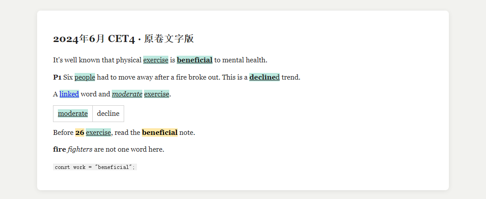
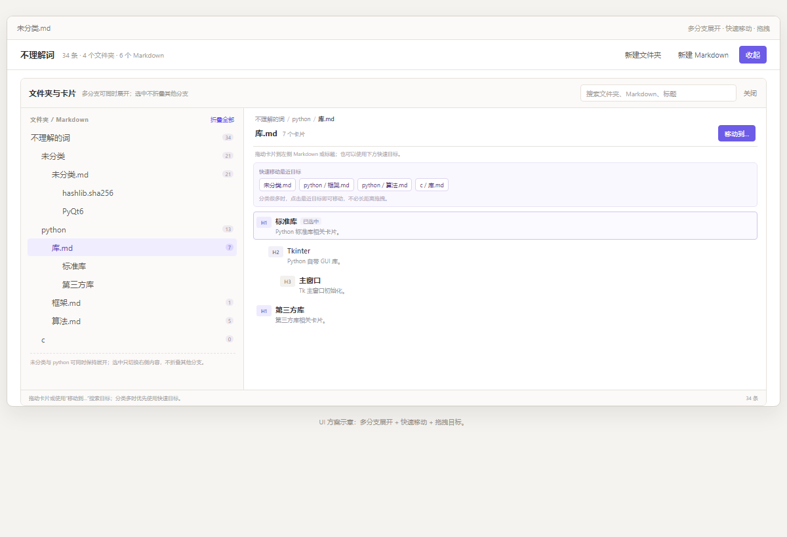
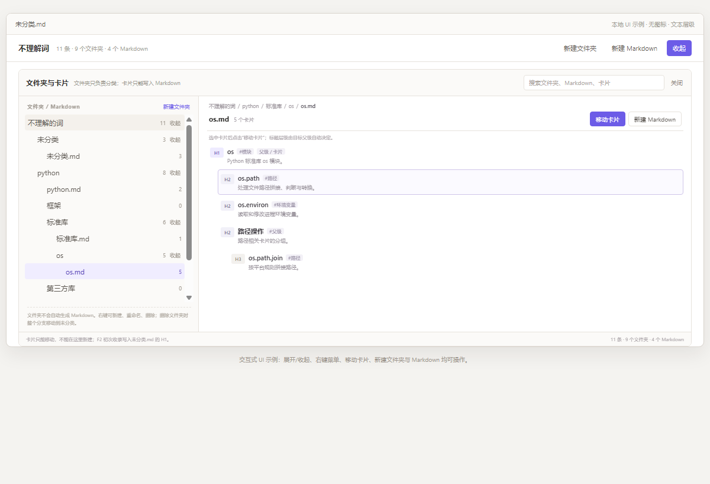

# 生词捕获（Obsidian 插件）

生词本是 **整个 vault 共享的词条集合**。支持：

- 英文单词：`beneficial`
- 英文短语：`give up`、`in the long run`
- 中文词语：`人工智能`、`经济`

在阅读视图或编辑视图中选中词条后按快捷键：

- 未收录 → 加入词表，并在所有 Markdown 文件中高亮
- 已收录 → 从词表移除，所有高亮同步消失
- 也可以直接编辑 `生词本.txt` 增加/删除词条，插件会自动重新加载
- 另有一个独立快捷键，把不理解的内容收录到 `不理解的词.txt`：不做格式校验，使用独立橙色高亮，并链接到文件夹中的 Markdown 标题；再按一次取消收录和链接

高亮不修改 md 源文件：

- 阅读视图：`CSS Custom Highlight API`
- 编辑视图：CodeMirror 6 Decoration



> 示意图：青绿色为插件高亮；`==26==` 的黄色为原有填空高亮；代码块默认不参与。

---

## 安装

插件目录需要放在目标 vault 的：

```text
<vault>/.obsidian/plugins/vocab-capture/
```

至少包含这三个文件：

```text
manifest.json
main.js
styles.css
```

然后：

1. 用 Obsidian 打开目标 vault。
2. 设置 → 第三方插件（社区插件）→ 关闭“安全模式/受限模式”。
3. 在已安装插件列表中启用 **生词捕获**。
4. 如果列表里没有，点“刷新”或重启 Obsidian。

> 本插件是单文件 `main.js`，直接 `require("obsidian")` 和 `require("@codemirror/view")`，不需要 npm、不需要构建。

---

## 使用

### 通过快捷键增删

1. 打开任意 Markdown 文件，切换到 **阅读视图** 或 **编辑视图**。
2. 选中一个词条：
   - 英文单词/短语：双击或拖选；
   - 中文词语：拖选；
   - 允许多行选择，插件会把换行折叠为空格（中文会去掉空白）。
3. 按下默认快捷键 `Alt+W`：
   - 未收录：新增并高亮；
   - 已收录：移除并取消高亮。

只接受一个词条：不支持中英混合、数字、内部标点；超长选择会被拒绝。

> toggle 判断的是“该词条是否在词集中”，不是“当前屏幕上是否正好有青绿色高亮”。因此词条在词集中但因为代码/表格设置没有显示高亮时，按键仍会移除它。

### 直接编辑生词本

默认词表：

```text
<vault>/生词本.txt
```

一行一个词条。直接在 Obsidian 中编辑该文件：

- 增加一行 → 保存/自动保存后，所有打开的文件出现该词条的高亮；
- 删除一行 → 保存/自动保存后，高亮消失。

内容示例：

```text
beneficial
give up
in the long run
人工智能
经济
```

词表是集合：

- 英文统一小写，大小写不敏感；
- 英文短语空白折叠；
- 中文去掉内部空白；
- 重复词条自动去重。

### 记录并链接“不理解的词”

这是独立于生词本的第二个记录功能：

- 独立文件：默认 `不理解的词.txt`
- 根目录：默认 `不理解的词/`
- 默认 Markdown：`不理解的词/未分类/未分类.md`，位于 `未分类` 文件夹中
- 独立快捷键：默认 `Alt+Q`（可在设置中录制）
- **不做格式校验**：中文、英文、标点、句子、任意选中内容都可以记录
- 同一快捷键切换收录/取消：未收录则追加，已收录则删除对应行
- 使用独立橙色高亮：与生词本的青绿色区分，所有 Markdown 文件都会高亮
- 点击橙色词条：打开其所在 Markdown 并跳转到对应标题
- 再次按快捷键：取消橙色高亮和链接，但保留 Markdown 中的标题与内容
- 首次收录：写入 `不理解的词/未分类/未分类.md`，卡片标题为 H1，空模板只有标题：

```md
# 新的词
```

### 文件夹、Markdown 与卡片

分类使用真实文件夹；文件夹只负责分类，不直接存放卡片。

```text
不理解的词/
  未分类/
    未分类.md            ← 默认卡片文件
  python/
    python.md            ← 手动创建
    标准库/
      os.md              ← 手动创建
  c/
    框架/                ← 空文件夹也可以存在
```

- 文件夹不会自动生成 Markdown，必须在管理界面手动创建
- 一个文件夹可以包含多个 Markdown，也可以保持为空
- 卡片是 Markdown 中的标题加内容
- 卡片标题级别由父级决定：

| 父级 | 卡片标题 |
|---|---|
| Markdown 文件 | H1 |
| H1 | H2 |
| H2 | H3 |
| H3 | H4 |
| H4 | H5 |
| H5 | H6 |
| H6 | 不能再添加子卡片 |

- 父级标题本身也可以作为卡片保存内容
- 卡片标题在同一个 Markdown 内唯一
- 管理界面只能**移动已有卡片**，不提供新建卡片
- 新建卡片仍由 F2 完成
- 移动卡片时自动重算标题级别；父级不能是自身子级
- 删除文件夹时，将文件夹内所有内容移动到 `未分类` 文件夹，不删除 Markdown 或卡片内容
- 删除 `未分类` 中的内容时直接删除

### 分类与卡片管理台

`未分类/未分类.md` 顶部使用紧凑栏；点击“管理”展开：

- 左栏：文件夹与 Markdown 文本树
- 右栏：当前 Markdown 的 H1–H6 标题/卡片
- 单击分类、Markdown 或标题仅展开/折叠该条目
- 双击条目在右侧显示其内容
- 多个分支可同时展开，单击折叠一个分支不影响其他分支
- 左侧提供“折叠全部”
- 文件夹和 Markdown 的操作放在右键菜单
- 右键文件夹可新建子文件夹或 Markdown；管理台内部不提供新建按钮
- 移动卡片支持拖拽到 Markdown 或标题
- 提供“移动到…”搜索弹窗和最近快速目标
- 分类多时可直接点击最近目标，不必长距离拖拽
- 删除文件夹会确认；普通文件夹的内容移动到 `未分类`，`未分类` 中的内容直接删除



> 界面示意图；实际颜色、字体和宽度随主题变化。



也可以打开 [交互式 UI 示例](docs/ui-demo.html) 体验展开、右键菜单和移动卡片。

### 从旧版迁移

旧版单个 `不理解的词.md` 会一次性迁移：

- 在 `不理解的词/未分类/` 下创建 `未分类.md`
- 旧文件中的二级标题卡片改为 H1 卡片
- 保留标题、释义、备注和正文链接
- 旧文件保留作为备份

迁移后 F2 仍写入 `未分类/未分类.md` 的 H1。

## 设置

在 设置 → 第三方插件 → 生词捕获 中：

| 设置 | 默认 | 说明 |
|---|---|---|
| 生词本文件 | `生词本.txt` | 相对 vault 根目录；也可填绝对路径（仅桌面版） |
| 收录快捷键 | `Alt+W` | 点“录制”后按新键；支持单键或组合键 |
| 不理解的词文件 | `不理解的词.txt` | 独立记录文件；橙色高亮 |
| 不理解词快捷键 | `Alt+Q` | 切换收录/取消；不做格式校验 |
| 不理解词根目录 | `不理解的词` | 分类根文件夹；默认文件位于 `未分类/` 下 |
| 不理解词默认 Markdown | `不理解的词/未分类/未分类.md` | F2 首次收录的写入目标；自动创建 |
| 不理解词高亮颜色 | `rgba(236, 144, 56, 0.36)` | 不理解词的独立高亮颜色 |
| 高亮颜色 | `rgba(64, 190, 160, 0.28)` | 任意 CSS 颜色 |
| 包含表格 | 开 | 表格中的词条也高亮；关闭后阅读视图和编辑视图都跳过表格行 |
| 包含代码 | 关 | 行内代码/代码块默认不处理 |
| 跳过已有高亮 | 开 | 跳过 `==26==` 这类已有 `<mark>`，避免叠色 |
| 按字母排序 | 开 | 关闭后按首次收录顺序写入 |

> 单键快捷键只在“阅读/编辑视图有选区”时生效；在输入框、命令面板、设置弹窗中不会拦截按键。

---

## 高亮范围

- **vault 内所有 Markdown 文件**
- 阅读视图 + 编辑视图（Live Preview / Source）
- 生词本自身不参与高亮
- Canvas、PDF、纯文本文件不处理

---

## 词条规则

### 英文单词/短语

- 1–12 个单词；总长度 ≤80 字符。
- 内部空白折叠；支持换行。
- 大小写不敏感。
- 每个单词允许拉丁字母、变音符号、撇号、连字符。
- 不允许内部标点、数字、斜杠。
- 整条短语按完整短语匹配；同时存在 `give` 和 `give up` 时优先更长的短语。
- 边界按拉丁字母/数字判断，允许英文紧贴中文，如 `使用 give up 方法`。

### 中文词语

- 2–20 个汉字；不支持单字。
- 去掉内部空白/换行。
- 去掉首尾中英文标点。
- 不允许内部标点、数字、中英混合。
- 采用**子串匹配**：`中国` 会命中 `中国人` 中的“中国”；`经济` 会命中 `经济危机`。
- 同时存在 `中国` 和 `中国人` 时，在 `中国人` 中优先完整词条。

### 匹配与高亮

- 阅读视图按段落/块拼接文本节点，支持跨 `<br>` 行内换行。
- 中文词条允许字与字之间有空白/换行；英文短语允许词与词之间有空白/换行。
- 编辑视图使用 CM6 Decoration；英文短语可跨源码行匹配。
- 编辑视图中 `**give** up` 这类被 Markdown 标记拆开的短语可能无法匹配；阅读视图不受影响。

---

## 支持哪些 md 格式

阅读视图基于渲染后的 DOM，天然支持：

- YAML frontmatter（不渲染，忽略）
- `#` ~ `######` 标题
- `> [!info]`、`> [!quote]`、`> [!article]`、`> [!questions]`、`> [!example]` 等 callout
- callout 内的多层 blockquote
- `**P1**`、`**A)**`、`**36.**` 等加粗标签
- 链接 `[文字](url)`（只处理文字，不碰 href）
- 表格 `td` / `th`（可关闭）
- 列表 `li`
- 行内代码、代码块（默认跳过）
- 已有的 `==高亮==`（默认跳过）
- 弯引号 `people’s`、不同连字符 `up‑to‑date`
- 被格式拆开的词，例如 `**decline**d`：按块拼接文本节点，用跨节点 `Range` 高亮

编辑视图默认跳过 frontmatter、代码、URL、已有 `==高亮==`；关闭“包含表格”时跳过表格行。

---

## 实现要点

- **词条**：`Set` 去重；按设置排序；UTF-8、一行一个词条；vault 内用 `vault.adapter`，绝对路径用 Node `fs`。
- **规范化**：`normalizeEntry()` 推断中文/英文，处理空白、标点、大小写、长度。
- **匹配**：中文子串 + `\s*`；英文整词/短语 + 拉丁边界 + `\s+`；长词优先。
- **阅读视图**：递归遍历 DOM，按块拼接文本节点，`<br>` 映射为换行；映射回 `Range` 写入 `CSS.highlights`。
- **编辑视图**：`registerEditorExtension` + `ViewPlugin` + `Decoration.mark`；只处理 `visibleRanges`，词表变化时通过 `StateEffect` 触发重建。
- **刷新**：`registerMarkdownPostProcessor`、`layout-change`、`active-leaf-change`、`file-open`、阅读视图 `MutationObserver`，以及编辑器的 CM6 更新。
- **直接编辑词表**：`vault` 的 `modify` / `create` / `delete` / `rename` 事件会重新加载词集并刷新高亮。
- **清理**：`onunload` 删除 `CSS.highlights` 注册、断开 observer、清空编辑器视图集合。

---

## 已知边界

- **中文子串匹配**：`中国` 会命中 `中国人`；这是召回优先的设计，不做分词。
- **中文单字**：默认不收录；需要单字时可直接编辑词表，但会被解析器忽略。
- **中英混合**：如 `AI技术` 目前不支持。
- **词形变化**：收录 `decline` 不会自动高亮 `declined`/`declining`。
- **编辑视图的 Markdown 标记**：`**decline**d` 这种“加粗部分 + 后缀”在源码中不连续，编辑视图可能只高亮 `decline` 部分，阅读视图不受影响。
- **跨段落**：阅读视图按段落分组匹配；跨 `<br>` 的行内换行支持，跨独立段落的短语不会合并高亮。
- **多窗口**：阅读视图的 CSS Highlight 覆盖主窗口；Obsidian popout 窗口暂未单独处理。
- **高亮是运行时效果**：插件禁用后高亮消失，但 txt 词集保留；不写入 md。
- **词表格式**：txt 中只应有“一行一个词条”；注释、非法行会被忽略，并在下次写入时被清理。
- **绝对路径词表**：桌面版可用，但不会监听 vault 外部的文件变化；修改后执行“重新加载生词本”。
- **不理解的词**：使用独立橙色高亮并链接到笔记标题；取消收录会移除高亮和链接，但不会删除 md 中的标题内容。
- **不要同时手动编辑词表并按键收录**：自动写入可能覆盖未保存的手动修改。

---

## 故障排查

| 现象 | 检查 |
|---|---|
| 按快捷键没反应 | 是否在阅读/编辑视图？是否有选区？快捷键是否被其他插件占用？ |
| 有“已收录”但没有高亮 | 该词条是否在代码/URL/表格中被排除？是否在生词本文件自身？ |
| 高亮没有出现在别的文章 | 词表是否已加载？编辑视图是否已打开/刷新？ |
| 编辑视图没有高亮 | Obsidian 是否成功加载 `@codemirror/view`；可在开发者工具查看 `[vocab-capture]` 警告 |
| 重启后没有高亮 | 打开任意 Markdown 阅读/编辑视图；再执行命令“刷新词条高亮” |
| 直接改 txt 后没变化 | 确认已保存；执行命令“重新加载生词本” |
| 词表路径改了但词没变 | 在设置里点“重新加载”，或执行命令“重新加载生词本” |

调试可在 Obsidian 开发者工具（Ctrl+Shift+I）控制台查看 `[vocab-capture]` 前缀的错误。

---

## 开发与测试

```bash
node --check main.js
node tests/core.test.js
node tests/dom.test.js
node tests/plugin.test.js
```

`tests/dom.test.js` 与 `tests/plugin.test.js` 需要 `jsdom`。
