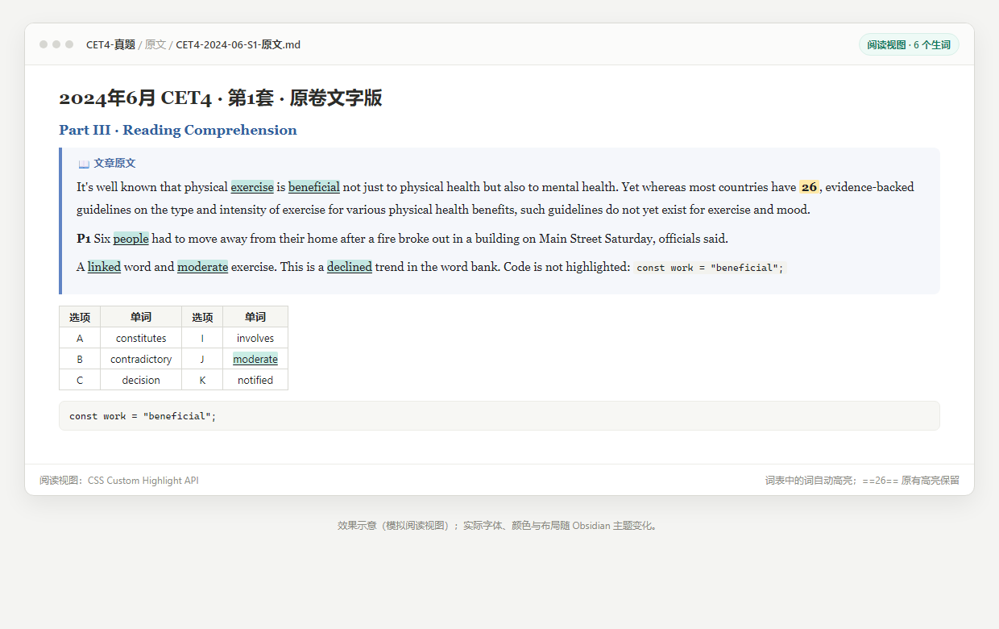
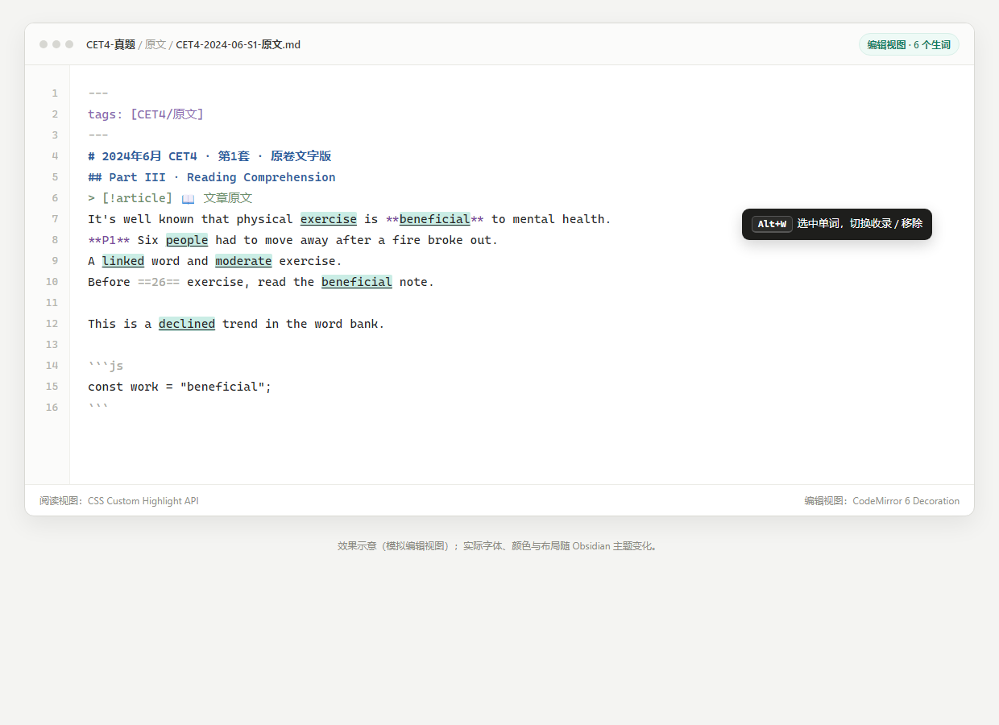
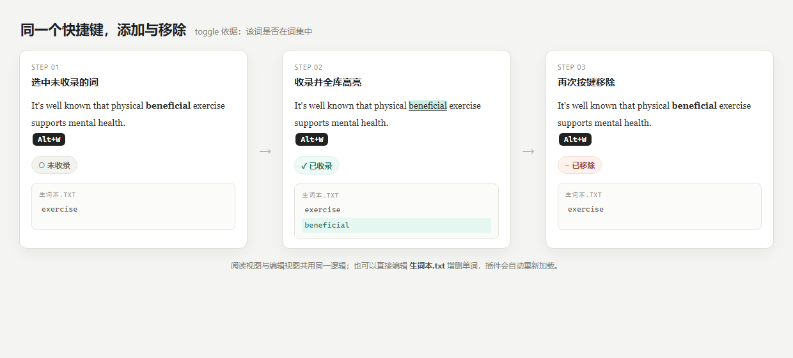

# 生词捕获

Obsidian 插件：把选中的英文单词、英文短语或中文词语收录到 **vault 级词集**，并在阅读视图与编辑视图中高亮所有出现位置；再次按下同一快捷键即可移除。

> 说明：以下图片为功能效果示意（模拟 Obsidian 界面），实际字体、行距与颜色随主题变化。



> 阅读视图：`exercise`、`beneficial`、`people`、`declined`、`linked`、`moderate` 为插件高亮；`==26==` 的黄色为原有填空高亮。



> 编辑视图：通过 CodeMirror 6 Decoration 渲染，与阅读视图共用同一词集。



> 同一个快捷键按“词条是否在词集中”切换收录/移除；也可以直接编辑 `生词本.txt`。

---

## 功能

- **vault 级词集**：词表位于 vault 根目录的 `生词本.txt`，一行一个词条，自动去重。
- **多类型词条**：英文单词、英文短语、中文词语；类型从内容自动推断。
- **一键增删**：阅读/编辑视图中选中词条，按 `Alt+W`：未收录则加入，已收录则移除。
- **自动高亮**：词表中的词条在 vault 内所有 Markdown 文件中高亮。
- **阅读视图**：使用 CSS Custom Highlight API，不修改 DOM、不修改 md。
- **编辑视图**：使用 CodeMirror 6 `Decoration.mark`，覆盖 Live Preview 与 Source 模式。
- **直接编辑词表**：在 Obsidian 中增删 `生词本.txt` 行，保存后自动重新加载。
- **不理解词独立收集**：另一个快捷键把任意选中内容追加到独立文件，不做格式校验，不参与高亮。
- **零构建**：单个 `main.js`，直接 `require("obsidian")` 与 `require("@codemirror/view")`，无需打包。

---

## 安装

要求 **Obsidian 1.5.0 或更高版本**。

### 方式一：Release 安装包

1. 从 [Releases](../../releases) 下载 `cet4-vocab-capture-0.4.0.zip`（仓库内 [`dist/cet4-vocab-capture-0.4.0.zip`](dist/cet4-vocab-capture-0.4.0.zip) 也可直接下载）。
2. 解压到：

```text
<你的 vault>/.obsidian/plugins/cet4-vocab-capture/
```

3. 打开 Obsidian → 设置 → 第三方插件 → 关闭“安全模式/受限模式”→ 启用 **生词捕获**。
4. 如果列表中没有，重启 Obsidian 或刷新插件列表。

### 方式二：手动安装

将以下文件放入同一目录即可：

```text
manifest.json
main.js
styles.css
```

`README.md` 与 `docs/` 仅用于说明，可省略。

### 方式三：BRAT

已安装 [BRAT](https://github.com/TfTHacker/obsidian42-brat) 的话，可直接添加：

```text
Asukabye/obsidian-vocab-capture
```

---

## 使用

### 快捷键增删

1. 打开任意 Markdown 文件，切到 **阅读视图** 或 **编辑视图**。
2. 选中一个词条：
   - 英文单词/短语：双击或拖选；
   - 中文词语：拖选；
   - 允许多行选择，换行会折叠为空格（中文会去掉空白）。
3. 按 `Alt+W`：
   - 未收录 → 加入词表并高亮；
   - 已收录 → 从词表移除，所有高亮消失。

只接受一个词条：不支持中英混合、数字、内部标点；超长选择会被拒绝。  
toggle 判断的是“该词条是否在词集中”，不是“当前屏幕上是否正好有青绿色高亮”。因此词条在词集中但因代码/表格设置没有显示高亮时，按键仍会移除它。

### 直接编辑生词本

默认词表：

```text
<你的 vault>/生词本.txt
```

一行一个词条。直接在 Obsidian 中增加或删除行，保存/自动保存后，所有打开文件的高亮会同步更新。

```text
beneficial
give up
in the long run
人工智能
经济
```

词表是集合：英文统一小写，英文短语空白折叠，中文去掉内部空白，重复词条自动去重。

### 记录“不理解的词”

另有独立的“不理解的词”收集功能：

- 独立文件：默认 `不理解的词.txt`
- 独立快捷键：默认 `Alt+Q`（可在设置中录制）
- **不做格式校验**：中文、英文、标点、句子、任意选中内容都可以记录
- 不参与高亮：只收集，不在正文中渲染
- 每条记录占一行；选择中的换行/制表符会折叠为空格
- 完全相同的内容不会重复追加
- 可直接编辑该文件增删内容

```text
Alt+W  → 收录/移除“生词本”词条，并高亮
Alt+Q  → 追加到“不理解的词”文件，不校验格式、不高亮
```

如果以后想把某条“不理解的词”纳入高亮，把它复制到 `生词本.txt` 即可。

---

## 词条规则

### 英文单词/短语

- 1–12 个单词；总长度 ≤80 字符。
- 内部空白折叠；支持换行。
- 大小写不敏感。
- 每个单词允许拉丁字母、变音符号、撇号、连字符。
- 不允许内部标点、数字、斜杠。
- 同时存在 `give` 和 `give up` 时优先更长的短语。
- 边界按拉丁字母/数字判断，允许英文紧贴中文，如 `使用 give up 方法`。

### 中文词语

- 2–20 个汉字；不支持单字。
- 去掉内部空白/换行。
- 去掉首尾中英文标点。
- 不允许内部标点、数字、中英混合。
- 采用**子串匹配**：`中国` 会命中 `中国人` 中的“中国”；`经济` 会命中 `经济危机`。
- 同时存在 `中国` 和 `中国人` 时，在 `中国人` 中优先完整词条。

### 跨行

- 英文短语允许单词之间有空格、制表符、换行。
- 中文词条允许字与字之间有空白、换行。
- 阅读视图支持同一段落内的 `<br>` 换行；独立段落之间不会合并匹配。
- 编辑视图支持源码中的跨行短语。

---

## 设置

| 设置 | 默认 | 说明 |
|---|---|---|
| 生词本文件 | `生词本.txt` | 相对 vault 根目录；也可填绝对路径（仅桌面版） |
| 收录快捷键 | `Alt+W` | 点击“录制”后按新键；支持单键或组合键 |
| 不理解的词文件 | `不理解的词.txt` | 独立记录文件；不参与高亮 |
| 不理解词快捷键 | `Alt+Q` | 记录选中内容；不做格式校验 |
| 高亮颜色 | `rgba(64, 190, 160, 0.28)` | 任意 CSS 颜色 |
| 包含表格 | 开 | 表格中的词条也高亮；关闭后阅读视图和编辑视图都跳过表格行 |
| 包含代码 | 关 | 行内代码、代码块默认不处理 |
| 跳过已有高亮 | 开 | 跳过 `==26==` 这类已有 `<mark>`，避免叠色 |
| 按字母排序 | 开 | 关闭后按首次收录顺序写入 |

单键快捷键只在“阅读/编辑视图有选区”时生效；输入框、命令面板、设置弹窗中不会拦截按键。

---

## 支持范围

- **所有 Markdown 文件**（阅读视图 + 编辑视图）
- 生词本自身不参与高亮
- 不处理 Canvas、PDF、纯文本文件

阅读视图基于渲染后的 DOM，支持：

- YAML frontmatter（不渲染，忽略）
- 标题、callout、多层 blockquote、列表、表格、链接
- `**P1**`、`**A)**`、`**36.**` 等加粗标签
- 行内代码、代码块（默认跳过）
- 已有 `==高亮==`（默认跳过）
- 弯引号 `people’s`、不同连字符 `up‑to‑date`
- 被格式拆开的词，例如 `**decline**d`：跨节点 `Range` 高亮

编辑视图基于源码做 CM6 Decoration，覆盖 Live Preview 与 Source。默认跳过 frontmatter、代码、URL、已有 `==高亮==`；关闭“包含表格”时跳过表格行。

---

## 实现

```text
manifest.json   插件清单
main.js         插件逻辑与编辑器扩展（无构建）
styles.css      编辑视图 mark 样式（阅读视图 ::highlight 由 main.js 动态注入）
tests/          Node 单元测试、jsdom DOM 测试、插件集成测试
docs/           功能展示图与截图源文件
dist/           可直接安装的 zip
```

- **词条**：`Set` 去重；UTF-8、一行一个词条；vault 内用 `vault.adapter`，绝对路径用 Node `fs`。
- **规范化**：`normalizeEntry()` 推断中文/英文，处理空白、标点、大小写、长度。
- **匹配**：中文子串 + `\s*`；英文整词/短语 + 拉丁边界 + `\s+`；长词优先。
- **阅读视图**：递归遍历 DOM，按块拼接文本节点，`<br>` 映射为换行；映射回 `Range` 写入 `CSS.highlights`。
- **编辑视图**：`registerEditorExtension` + `ViewPlugin` + `RangeSetBuilder` + `Decoration.mark`；只处理 `visibleRanges`，词表变化时通过 `StateEffect` 触发重建。
- **直接编辑词表**：`vault` 的 `modify` / `create` / `delete` / `rename` 事件触发重载并刷新。
- **不修改 md**：所有高亮都是运行时渲染效果。
- **改名安全**：阅读视图的 `::highlight()` 样式由 `HIGHLIGHT_NAME` 动态注入，修改插件 ID/名称后不会出现注册名与 CSS 选择器不一致。

---

## 验证

- `node --check main.js`
- 纯函数测试：30 项
- jsdom DOM 测试：9 项
- 插件集成测试：7 项
- Chromium 150 中验证过中文词语、英文短语、跨 `<br>` 高亮

CM6 扩展使用 Obsidian 运行时提供的 `@codemirror/view` / `@codemirror/state`，与 Obsidian 使用同一份 CodeMirror 实例，不重复打包。项目未包含自动化 Obsidian UI 测试；升级 Obsidian 或更换主题后，建议先在目标 vault 做一次手工验收。

---

## 已知边界

- **中文子串匹配**：`中国` 会命中 `中国人`；这是召回优先的设计，不做分词。
- **中文单字**：默认不收录。
- **中英混合**：如 `AI技术` 目前不支持。
- **词形变化**：收录 `decline` 不会自动高亮 `declined` / `declining`。
- **编辑视图的 Markdown 标记**：编辑器基于源码匹配；`**decline**d` 这种“加粗部分 + 后缀”在源码中不是连续的 `declined`，编辑视图可能只高亮 `decline` 部分；阅读视图不受影响。
- **跨段落**：阅读视图按段落分组匹配；跨 `<br>` 的行内换行支持，跨独立段落的短语不会合并高亮。
- **代码/URL**：编辑视图默认跳过；打开“包含代码”后，fenced code 与行内代码也会参与匹配。
- **多窗口**：阅读视图的 CSS Highlight 覆盖主窗口；Obsidian popout 窗口未做专门验证。
- **绝对路径词表**：桌面版可用，但不会监听 vault 外部的文件变化；修改后执行“重新加载生词本”。
- **不理解的词**：默认不参与高亮；其文件不做格式校验，但每条记录占一行，选择中的换行会折叠为空格。
- **不要同时手动编辑词表并按键收录**：自动写入可能覆盖未保存的手动修改。
- 没有插件内可视化管理界面；词表的增删通过快捷键或直接编辑 txt 完成。

---

## 开发与测试

```bash
npm install
npm run check
npm run test:all
```

`tests/dom.test.js` 与 `tests/plugin.test.js` 需要 `jsdom`。

---

## License

[MIT](LICENSE)
